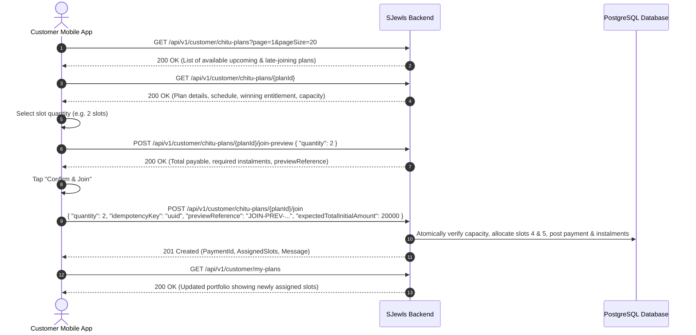
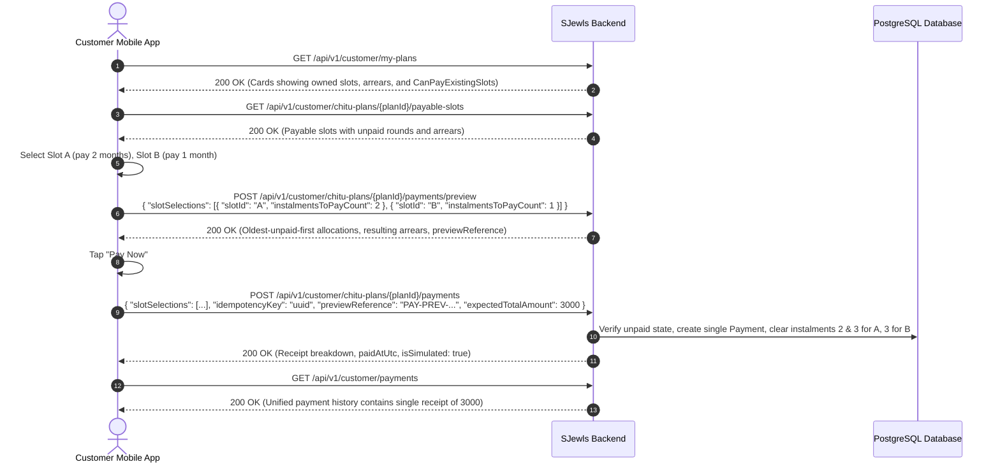
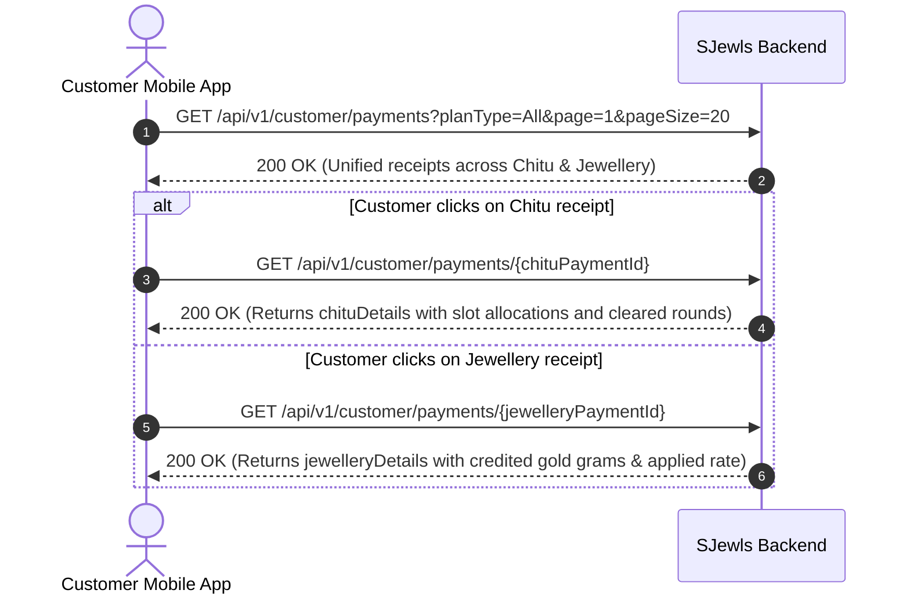

# SJewls Mobile Developer Handover Guide: Customer Chitu & Unified Payments

This document provides complete integration specifications, endpoint references, request/response contracts, and UI workflow sequences for the customer-facing **Chitu Backend** and **Unified Payment History** APIs in the SJewls mobile application.

Interactive Scalar API Reference is available live at:
👉 **[http://localhost:5230/scalar/mobile](http://localhost:5230/scalar/mobile)**

---

## 1. Architecture & Source of Truth

The mobile customer Chitu endpoints share the exact same underlying PostgreSQL database, entities, ledger allocations, raffle draws, and notifications as the admin portal:
- **Customers & Branches**: Customer identity is strictly derived on the server via JWT bearer tokens (`ClaimsPrincipal`). The client cannot spoof identity or branch scope.
- **Sequential Slot Allocation**: Slot numbers within each plan are assigned sequentially (`PLANCODE-001`, `PLANCODE-002`, ...). Winning slots **never** free up capacity or recycle slot numbers.
- **Currency**: All amounts and transactions for Jaffna Heritage Branch are in **LKR** (Sri Lankan Rupee).
- **Winning Entitlement Formula**:
  $$\text{Winning Entitlement} = \text{Monthly Slot Price} \times \text{Duration in Months}$$
- **Shared Monthly Schedule**: Each plan has a fixed monthly due day (e.g. 10th of every month).
- **Instalments**: Full monthly instalments only. No partial monthly payments, no skipping overdue months. Oldest unpaid instalments are allocated first.
- **Winning Slot Independence**: When a slot wins a raffle, all its future instalment obligations cease. Any other slots owned by the same customer remain active and payable.
- **Atomic Posting**: Slot assignment, initial payments, instalment status, and allocations are saved in a single database transaction.
- **Idempotency**: All payment mutations require an `IdempotencyKey` (sent via JSON body or `X-Idempotency-Key` header) to guarantee single posting across network retries.

---

## 2. API Surface Reference

All customer endpoints require authentication: `Authorization: Bearer <jwt_token>`.

| Feature Area | Method | Endpoint | Description |
| :--- | :--- | :--- | :--- |
| **Discovery** | `GET` | `/api/v1/customer/chitu-plans` | Paginated list of plans open for joining or late-joining in customer's branch. |
| **Plan Details** | `GET` | `/api/v1/customer/chitu-plans/{planId}` | Detailed plan terms, winning entitlement, and round schedule. |
| **Join Preview** | `POST` | `/api/v1/customer/chitu-plans/{planId}/join-preview` | Read-only calculation of required initial payment for requested slot quantity. |
| **Confirm & Join** | `POST` | `/api/v1/customer/chitu-plans/{planId}/join` | Idempotently posts initial payment, allocates sequential slots, and marks initial rounds paid. |
| **My Plans** | `GET` | `/api/v1/customer/chitu-investments` | Grouped portfolio: 1 card per plan containing all individual slots, commitments, and arrears. |
| **My Plans (Alias)**| `GET` | `/api/v1/customer/my-plans` | Convenience alias for `/chitu-investments`. |
| **Grouped Plan** | `GET` | `/api/v1/customer/chitu-investments/{planId}` | Single plan portfolio details for the customer. |
| **Slot Details** | `GET` | `/api/v1/customer/chitu-slots/{slotId}` | Individual slot status, full instalment schedule, and winning benefit claim info. |
| **Slot Payments** | `GET` | `/api/v1/customer/chitu-slots/{slotId}/payments` | Payment receipts linked specifically to this slot. |
| **Payable Slots** | `GET` | `/api/v1/customer/chitu-plans/{planId}/payable-slots` | Customer's eligible payable slots for that plan with unpaid rounds and arrears. |
| **Contribution Preview** | `POST` | `/api/v1/customer/chitu-plans/{planId}/payments/preview` | Preview calculation of per-slot allocations, resulting arrears, and raffle eligibility. |
| **Pay Now** | `POST` | `/api/v1/customer/chitu-plans/{planId}/payments` | Idempotent payment posting for existing slots. |
| **Unified History** | `GET` | `/api/v1/customer/payments` | Paginated unified list across **both Chitu and Jewellery** plans. |
| **Payment Detail** | `GET` | `/api/v1/customer/payments/{paymentId}` | Detailed receipt breakdown (slots for Chitu, credited gold grams/rate for Jewellery). |

---

## 3. End-to-End Mobile Flows

### Flow A: Active Chitu Discovery & Joining



#### Pre-Enrolment vs. Late Joining Rules
- **Pre-Enrolment** (`today < StartDate`):
  Initial payment covers **Round 1 only** for each slot:
  $$\text{Total Initial Amount} = \text{Monthly Slot Price} \times 1 \times \text{Quantity}$$
- **Late Joining** (`StartDate <= today <= EndDate`):
  Initial payment covers **all elapsed rounds from Round 1 through Current Round**:
  $$\text{Total Initial Amount} = \text{Monthly Slot Price} \times \text{CurrentRoundIndex} \times \text{Quantity}$$
  *The plan schedule remains the original shared schedule. Joining does not create a personal duration.*

---

### Flow B: Contributing to Existing Slots



#### Key Payment Rules
1. **Oldest-Unpaid-First**: Payments strictly allocate to the earliest unpaid round first, then forward.
2. **Partial Overdue Payments**: If a customer owes 3 overdue months and pays 1 month, month 1 is marked Paid. Months 2 and 3 remain overdue. The slot **remains ineligible for the raffle** until all arrears through the raffle round are paid.
3. **Advance Payments**: Advance payments beyond the current round are allowed up to the plan's duration.
4. **Winning Slots**: Winning slots stop future payment obligations and cannot be selected for payment.

---

### Flow C: Unified Customer Payment History



---

## 4. Exact JSON Request & Response Examples

### A. Join Preview (`POST /api/v1/customer/chitu-plans/{planId}/join-preview`)

#### Request:
```json
{
  "quantity": 2
}
```

#### Response (`200 OK`):
```json
{
  "planId": "3fa85f64-5717-4562-b3fc-2c963f66afa6",
  "planCode": "CHT-GOLD01",
  "planName": "Gold Sovereign Chitu",
  "currency": "LKR",
  "monthlySlotPrice": 5000.00,
  "requestedQuantity": 2,
  "totalOrdinaryMonthlyPayment": 10000.00,
  "requiredInitialInstalmentsPerSlot": 1,
  "requiredInitialAmountPerSlot": 5000.00,
  "totalInitialAmountPayable": 10000.00,
  "availableSlotsCount": 18,
  "winningEntitlementPerSlot": 60000.00,
  "startDate": "2026-11-10",
  "endDate": "2027-10-10",
  "currentRoundIndex": 1,
  "nextRaffleRoundIndex": 1,
  "nextRaffleDate": "2026-11-10",
  "existingOwnedSlotsCount": 0,
  "previewReference": "JOIN-PREV-7b3b4f9e1c2a4b88",
  "previewCreatedAtUtc": "2026-10-20T14:30:00Z",
  "previewExpiresAtUtc": "2026-10-20T14:45:00Z"
}
```

---

### B. Confirm & Join (`POST /api/v1/customer/chitu-plans/{planId}/join`)

#### Request:
```json
{
  "quantity": 2,
  "idempotencyKey": "a821e27b-23e5-4d38-95ef-59c6b71bf381",
  "previewReference": "JOIN-PREV-7b3b4f9e1c2a4b88",
  "expectedTotalInitialAmount": 10000.00
}
```

#### Response (`201 Created`):
```json
{
  "paymentId": "e3b0c442-98fc-1c14-9afb-4c8996fb9242",
  "planId": "3fa85f64-5717-4562-b3fc-2c963f66afa6",
  "planCode": "CHT-GOLD01",
  "planName": "Gold Sovereign Chitu",
  "slotsCount": 2,
  "totalAmountPaid": 10000.00,
  "currency": "LKR",
  "isSimulated": true,
  "assignedSlots": [
    {
      "slotId": "91a27e01-1b2c-4ef1-90a1-87291a28cb01",
      "slotNumber": 3,
      "slotDisplayCode": "CHT-GOLD01-003",
      "initialMonthsPaid": 1,
      "activatedAtUtc": "2026-10-20T14:32:00Z"
    },
    {
      "slotId": "91a27e01-1b2c-4ef1-90a1-87291a28cb02",
      "slotNumber": 4,
      "slotDisplayCode": "CHT-GOLD01-004",
      "initialMonthsPaid": 1,
      "activatedAtUtc": "2026-10-20T14:32:00Z"
    }
  ],
  "message": "Successfully joined Gold Sovereign Chitu with 2 slot(s)."
}
```

---

### C. My Plans / Portfolio (`GET /api/v1/customer/chitu-investments`)

#### Response (`200 OK`):
```json
{
  "items": [
    {
      "planId": "3fa85f64-5717-4562-b3fc-2c963f66afa6",
      "branchId": "d8e3b2a1-0000-0000-0000-000000000001",
      "branchName": "Jaffna Heritage Branch",
      "code": "CHT-GOLD01",
      "name": "Gold Sovereign Chitu",
      "description": "Monthly pure gold savings raffle plan.",
      "redemptionType": "Gold",
      "currency": "LKR",
      "durationMonths": 12,
      "startDate": "2026-11-10",
      "endDate": "2027-10-10",
      "currentRoundIndex": 1,
      "nextRaffleRoundIndex": 1,
      "nextRaffleDate": "2026-11-10",
      "planStatus": "Active",
      "totalOwnedSlotsCount": 2,
      "activeSlotsCount": 2,
      "winningSlotsCount": 0,
      "monthlySlotPrice": 5000.00,
      "normalMonthlyCommitment": 10000.00,
      "actualOutstandingDueThroughCurrentRound": 0.00,
      "currentRoundPaidSlotsCount": 2,
      "currentRoundUnpaidSlotsCount": 0,
      "totalConfirmedContributions": 10000.00,
      "canPurchaseAdditionalSlots": true,
      "canPayExistingSlots": true,
      "isSimulated": true,
      "slots": [
        {
          "slotId": "91a27e01-1b2c-4ef1-90a1-87291a28cb01",
          "slotNumber": 3,
          "slotDisplayCode": "CHT-GOLD01-003",
          "joinedAtUtc": "2026-10-20T14:32:00Z",
          "monthlySlotPrice": 5000.00,
          "durationMonths": 12,
          "instalmentsPaidCount": 1,
          "paidThroughRound": 1,
          "arrearsMonths": 0,
          "arrearsAmount": 0.00,
          "advancePaidMonths": 0,
          "advancePaidAmount": 0.00,
          "isCurrentRoundPaid": true,
          "totalConfirmedContributions": 5000.00,
          "slotStatus": "Active",
          "isWinner": false,
          "winningRoundIndex": null,
          "winningDrawDate": null,
          "winningPrizeAmount": null,
          "winningEntitlementClaimed": false,
          "isRaffleEligible": true,
          "raffleEligibilityReason": "Eligible for raffle draw."
        }
      ]
    }
  ],
  "totalCount": 1,
  "page": 1,
  "pageSize": 20,
  "totalPages": 1
}
```

---

### D. Existing Slot Payment Preview (`POST /api/v1/customer/chitu-plans/{planId}/payments/preview`)

#### Request:
```json
{
  "slotSelections": [
    {
      "slotId": "91a27e01-1b2c-4ef1-90a1-87291a28cb01",
      "instalmentsToPayCount": 2
    }
  ]
}
```

#### Response (`200 OK`):
```json
{
  "planId": "3fa85f64-5717-4562-b3fc-2c963f66afa6",
  "planCode": "CHT-GOLD01",
  "planName": "Gold Sovereign Chitu",
  "currency": "LKR",
  "monthlySlotPrice": 5000.00,
  "totalPayableAmount": 10000.00,
  "slots": [
    {
      "slotId": "91a27e01-1b2c-4ef1-90a1-87291a28cb01",
      "slotDisplayCode": "CHT-GOLD01-003",
      "instalmentsToPayCount": 2,
      "amountAllocated": 10000.00,
      "clearedRounds": [2, 3],
      "remainingArrearsAfterPayment": 0.00,
      "advanceCoverageMonthsAfterPayment": 2,
      "resultingCurrentRoundCoverage": true,
      "resultingRaffleEligible": true
    }
  ],
  "previewReference": "PAY-PREV-3a7b9c1d",
  "previewCreatedAtUtc": "2026-10-20T14:35:00Z",
  "previewExpiresAtUtc": "2026-10-20T14:50:00Z"
}
```

---

### E. Unified Customer Payment History (`GET /api/v1/customer/payments`)

#### Response (`200 OK`):
```json
{
  "items": [
    {
      "paymentId": "e3b0c442-98fc-1c14-9afb-4c8996fb9242",
      "planType": "Chitu",
      "planId": "3fa85f64-5717-4562-b3fc-2c963f66afa6",
      "planName": "Gold Sovereign Chitu",
      "planCode": "CHT-GOLD01",
      "currency": "LKR",
      "amount": 10000.00,
      "status": "Succeeded",
      "paymentMethod": "MockOnline",
      "provider": "Simulated",
      "providerReference": "SIM-CHITU-7c98b1a2",
      "createdAtUtc": "2026-10-20T14:32:00Z",
      "confirmedAtUtc": "2026-10-20T14:32:00Z",
      "isSimulated": true,
      "allocationsCount": 2,
      "slotsCoveredCount": 2,
      "hasDetails": true,
      "summaryDescription": "Initial Chitu join: 2 slot(s) in Gold Sovereign Chitu"
    },
    {
      "paymentId": "f7a1d234-88aa-4bb1-9cc2-111122223333",
      "planType": "Jewellery",
      "planId": "11112222-3333-4444-5555-666677778888",
      "planName": "Swarna Gold Accumulation",
      "planCode": "ENR-A1B2C3D4",
      "currency": "LKR",
      "amount": 25000.00,
      "status": "Succeeded",
      "paymentMethod": "BankTransfer",
      "provider": "Cash/Bank",
      "providerReference": "TXN-JEW-789",
      "createdAtUtc": "2026-10-19T10:15:00Z",
      "confirmedAtUtc": "2026-10-19T10:15:00Z",
      "isSimulated": false,
      "allocationsCount": 1,
      "slotsCoveredCount": null,
      "hasDetails": true,
      "summaryDescription": "Jewellery contribution: 0.852g credited"
    }
  ],
  "totalCount": 2,
  "page": 1,
  "pageSize": 20,
  "totalPages": 1
}
```

#### Detailed Breakdown (`GET /api/v1/customer/payments/{paymentId}`):
```json
{
  "paymentId": "e3b0c442-98fc-1c14-9afb-4c8996fb9242",
  "planType": "Chitu",
  "planId": "3fa85f64-5717-4562-b3fc-2c963f66afa6",
  "planName": "Gold Sovereign Chitu",
  "planCode": "CHT-GOLD01",
  "currency": "LKR",
  "amount": 10000.00,
  "status": "Succeeded",
  "isSimulated": true,
  "chituDetails": {
    "planId": "3fa85f64-5717-4562-b3fc-2c963f66afa6",
    "planName": "Gold Sovereign Chitu",
    "planCode": "CHT-GOLD01",
    "monthlySlotPrice": 5000.00,
    "isJoiningPayment": true,
    "slotAllocations": [
      {
        "slotId": "91a27e01-1b2c-4ef1-90a1-87291a28cb01",
        "slotNumber": 3,
        "slotDisplayCode": "CHT-GOLD01-003",
        "allocatedAmount": 5000.00,
        "instalmentRoundsCovered": [1],
        "isJoiningPayment": true
      },
      {
        "slotId": "91a27e01-1b2c-4ef1-90a1-87291a28cb02",
        "slotNumber": 4,
        "slotDisplayCode": "CHT-GOLD01-004",
        "allocatedAmount": 5000.00,
        "instalmentRoundsCovered": [1],
        "isJoiningPayment": true
      }
    ]
  },
  "jewelleryDetails": null
}
```

---

## 5. Error & Conflict Codes

| HTTP Status | Error Code | Description / Client Action |
| :--- | :--- | :--- |
| `409 Conflict` | `PreviewChanged` | Terms, required catch-up rounds, or payable amounts changed after preview (or another payment cleared instalments). Mobile must prompt the user with a fresh preview. |
| `501 Not Implemented` | `PaymentProviderNotConfigured` | Real gateway integration is pending, and simulation mode is disabled on the server. |
| `400 Bad Request` | *Various* | Validation error (e.g. invalid slot quantity, non-whole multiple of instalment amount, exceeding capacity). |
| `403 Forbidden` | *Various* | Attempting to access or join a plan belonging to another branch, or inactive customer account. |
| `404 Not Found` | *Various* | Slot or plan ID does not exist or does not belong to the authenticated customer. |

---

## 6. Simulated Payment Provider Configuration

In `backend/src/SJewls.Api/appsettings.json`:
```json
"ChituPayments": {
  "Provider": "Simulated",
  "EnableSimulation": true
}
```

**Production Security Protection**:
If `EnableSimulation = true` is deployed to Production (`ASPNETCORE_ENVIRONMENT=Production` or `App:Environment=Production`), the application will immediately abort startup with `CRITICAL SECURITY ERROR: ChituPayments:EnableSimulation cannot be enabled in a Production environment.`

---

## 7. Future Payment Gateway Foundation

When a real payment gateway (e.g. PayHere, Stripe, or WebXPay) is integrated:
1. Mobile calls `/join-preview` or `/payments/preview` as before.
2. Mobile requests `/initiate-payment` -> Backend returns a real `clientSecret` or gateway redirect URL.
3. User completes gateway payment.
4. Server webhook or verified return endpoint receives cryptographic proof from the gateway.
5. Server invokes the existing atomic ledger posting method to allocate slots and mark instalments paid.
*Mobile UI logic and contracts remain identical.*
