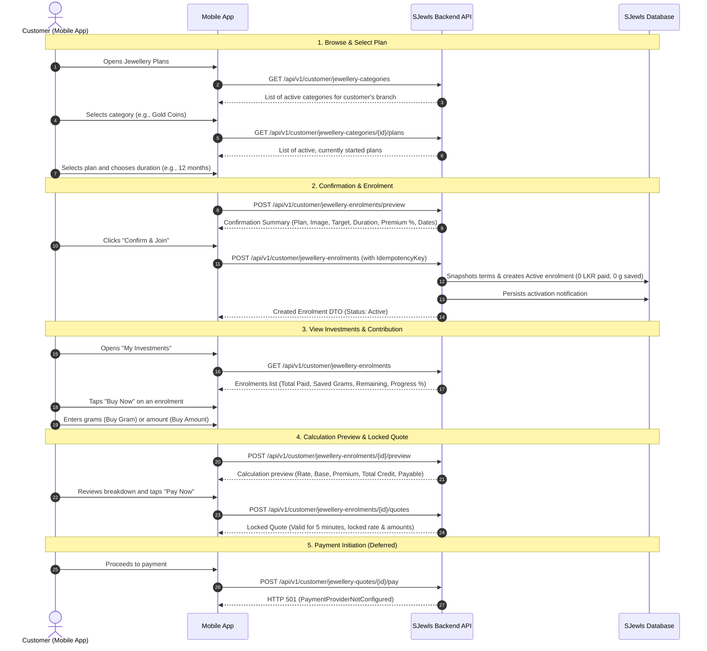
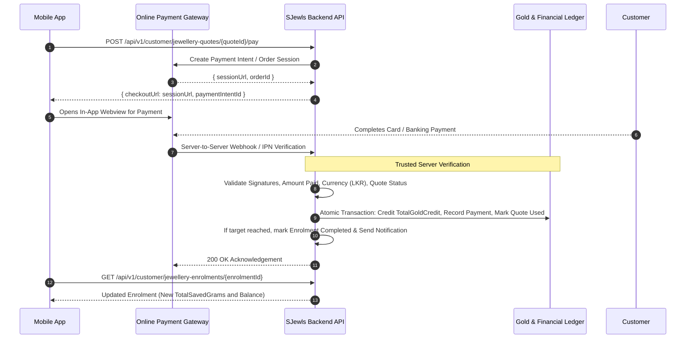

# SJewls Mobile Jewellery Plans Backend Integration Guide

**Version:** 1.0.0  
**Target Clients:** iOS & Android Mobile Apps (Flutter, React Native, Expo, Native)  
**Interactive Scalar API Reference:** `http://localhost:5230/scalar/mobile`  
**OpenAPI Specification:** `http://localhost:5230/openapi/mobile.json`  
**Base URL (Local Development):** `http://localhost:5230`  
**Base URL (Staging / Production):** Configured via environment gateway  

---

## 1. Executive Summary & Core Architectural Principles

The SJewls Jewellery Plan system allows retail customers in Sri Lanka to save toward target jewellery products by accumulating 24K gold grams at live market rates. Customers join a plan, choose an offered duration, and contribute whenever they choose without fixed monthly instalments.

### Key Rules Every Mobile Developer Must Follow

1. **Backend Values Are Authoritative:**  
   The mobile application **must never calculate gold grams, premium charges, or payable totals client-side**. All calculations must originate from the backend calculation preview and locked quote endpoints.
2. **Strict Separation of Credited Gold vs. Charge Breakdown:**  
   - `TotalGoldCredit` is the **only** figure added to customer balances, remaining target, progress, and completion.  
   - `ChargeableGoldGrams` is a **charge-calculation breakdown field only** in Buy Gram mode. It must **never** be labeled "Total Gold Credit" or displayed as gold acquired.
3. **Quotes & Previews Do Not Credit Gold:**  
   Generating an informational preview or creating a locked payment quote does **not** alter ledger balances or reserve gold.
4. **No Client-Side Payment Simulation:**  
   The mobile app's payment success screen is **not** verification. Gold grams are credited **strictly upon server-side verified gateway callback**.
5. **Gateway Status (Deferred):**  
   Calling the payment initiation endpoint returns HTTP 501 with `code: "PaymentProviderNotConfigured"`. The app must inform the customer that online checkout is being configured, without faking checkout or simulating success.
6. **No Karat Display to Customers:**  
   All rates and grams are calculated internally on a 24K gold basis, but the customer UI displays the gold rate simply as the **"Latest Gold Rate (per gram)"** without karat badges.

---

## 2. Customer Journey Flow



---

## 3. Authoritative Payment Calculation Engine

There are **two intentionally different contribution modes**. Decimal arithmetic is enforced throughout the backend.

### Variable Definitions
- $R$ = Applicable 24K gold rate in LKR per gram.
- $p$ = Premium fraction $= \frac{\text{PremiumPercentage}}{100}$ (e.g. $5\% \implies 0.05$).
- Currency amounts in LKR are rounded to **2 decimal places** using standard midpoint rounding away from zero (`MidpointRounding.AwayFromZero`).
- Credited grams are rounded down to **4 decimal places** (`MidpointRounding.ToZero`) to guarantee the customer target is never artificially exceeded.

---

### Mode A: BUY GRAM (Customer Enters Grams)

The customer specifies the exact weight of gold they want credited to their plan balance.

$$\begin{aligned}
G &= \text{Requested Credited Grams} \\
\text{BaseGoldGrams} &= G \\
\text{PremiumGrams} &= G \times p \\
\text{ChargeableGoldGrams} &= G + \text{PremiumGrams} \\
\text{BaseAmount} &= G \times R \\
\text{PremiumAmount} &= \text{PremiumGrams} \times R \\
\text{AmountToPay} &= \text{Round}(\text{BaseAmount} + \text{PremiumAmount}, 2) \\
\mathbf{TotalGoldCredit} &= \mathbf{G}
\end{aligned}$$

> [!IMPORTANT]
> **Strict Rule for Buy Gram:**
> The premium **increases the money charged** to the customer. It **does NOT** increase or reduce the customer's credited grams.
> - The customer pays for $\text{ChargeableGoldGrams} = G \times (1 + p)$.
> - The customer is credited **strictly $G$ grams**.
> - **NEVER** display $\text{ChargeableGoldGrams}$ as Total Gold Credit!

---

### Mode B: BUY AMOUNT (Customer Enters LKR Amount)

The customer specifies the total money in LKR they wish to contribute.

$$\begin{aligned}
A &= \text{Entered Amount in LKR} \\
\text{BaseGoldGrams} &= \frac{A}{R} \\
\text{PremiumGrams} &= \text{BaseGoldGrams} \times p \\
\mathbf{TotalGoldCredit} &= \text{RoundDown}(\text{BaseGoldGrams} - \text{PremiumGrams}, 4) \\
\mathbf{AmountToPay} &= \mathbf{A}
\end{aligned}$$

> [!IMPORTANT]
> **Strict Rule for Buy Amount:**
> The premium **reduces the credited grams**. It **does NOT** add any extra monetary surcharge.
> - The customer pays **only** the amount entered ($A$).
> - The customer is credited $\text{BaseGoldGrams} \times (1 - p)$.
> - Do not apply any additional fee or markup.

---

## 4. Canonical Specification Examples

### Example 1: Buy Gram (100.0 g requested)
- **Inputs:** Requested grams $G = 100.0\text{ g}$, Premium $= 5.0\%$, Rate $R = 25,000.00\text{ LKR/g}$, Remaining Target $= 100.0\text{ g}$.
- **Calculations:**
  - $\text{BaseGoldGrams} = 100.0\text{ g}$
  - $\text{PremiumGrams} = 100.0 \times 0.05 = 5.0\text{ g}$
  - $\text{ChargeableGoldGrams} = 100.0 + 5.0 = 105.0\text{ g}$
  - $\text{BaseAmount} = 100.0 \times 25,000 = 2,500,000.00\text{ LKR}$
  - $\text{PremiumAmount} = 5.0 \times 25,000 = 125,000.00\text{ LKR}$
  - $\text{AmountToPay} = 2,500,000.00 + 125,000.00 = 2,625,000.00\text{ LKR}$
  - $\mathbf{TotalGoldCredit} = \mathbf{100.0\text{ g}}$
- **Mobile Display:**
  - **Total Gold Credit:** `100.0000 g`
  - **Amount to Pay:** `LKR 2,625,000.00`
  - **Chargeable Equivalent (Breakdown):** `105.0000 g`

### Example 2: Buy Gram (0.5 g requested)
- **Inputs:** Requested grams $G = 0.5\text{ g}$, Premium $= 5.0\%$, Rate $R = 20,000.00\text{ LKR/g}$, Remaining Target $= 5.0\text{ g}$.
- **Calculations:**
  - $\text{BaseGoldGrams} = 0.5\text{ g}$
  - $\text{PremiumGrams} = 0.5 \times 0.05 = 0.025\text{ g}$
  - $\text{ChargeableGoldGrams} = 0.5 + 0.025 = 0.525\text{ g}$
  - $\text{BaseAmount} = 0.5 \times 20,000 = 10,000.00\text{ LKR}$
  - $\text{PremiumAmount} = 0.025 \times 20,000 = 500.00\text{ LKR}$
  - $\text{AmountToPay} = 10,000.00 + 500.00 = 10,500.00\text{ LKR}$
  - $\mathbf{TotalGoldCredit} = \mathbf{0.5\text{ g}}$
- **Mobile Display:**
  - **Total Gold Credit:** `0.5000 g`
  - **Amount to Pay:** `LKR 10,500.00`
  - **Chargeable Equivalent (Breakdown):** `0.5250 g`

### Example 3: Buy Amount (LKR 49,230.00 entered)
- **Inputs:** Entered amount $A = 49,230.00\text{ LKR}$, Rate $R = 25,000.00\text{ LKR/g}$, Premium $= 5.0\%$, Remaining Target $= 10.0\text{ g}$.
- **Calculations:**
  - $\text{BaseGoldGrams} = 49,230 / 25,000 = 1.9692\text{ g}$
  - $\text{PremiumGrams} = 1.9692 \times 0.05 = 0.09846\text{ g}$
  - $\text{Gross Difference} = 1.9692 - 0.09846 = 1.87074\text{ g}$
  - $\mathbf{TotalGoldCredit} = \text{Truncate}(1.87074, 4) = \mathbf{1.8707\text{ g}}$
  - $\mathbf{AmountToPay} = \mathbf{49,230.00\text{ LKR}}$
- **Mobile Display:**
  - **Total Gold Credit:** `1.8707 g`
  - **Amount to Pay:** `LKR 49,230.00`
  - **Premium Deduction (Breakdown):** `0.0985 g (5%)`

---

## 5. Mobile Display Contract

| Screen UI Element | Buy Gram Mode | Buy Amount Mode | Notes / Rules |
| :--- | :--- | :--- | :--- |
| **Total Gold Credit (Headline)** | `response.totalGoldCredit` | `response.totalGoldCredit` | **Must always equal `totalGoldCredit`**. NEVER use `chargeableGoldGrams`. |
| **Amount to Pay (Button / Total)** | `response.amountToPay` | `response.amountToPay` | Formatted as `LKR #,##0.00`. In Buy Amount, equals entered amount. |
| **Base Gold Grams** | `response.baseGoldGrams` | `response.baseGoldGrams` | Display in calculation details breakdown. |
| **Premium Surcharge / Deduction** | `response.premiumAmount` (LKR) | `response.premiumGrams` (g) | Clearly indicates the plan's snapshotted premium percentage. |
| **Chargeable Weight** | `response.chargeableGoldGrams` | *N/A (null)* | Label strictly as *"Chargeable Equivalent (Breakdown)"*, never "Gold Credit". |
| **Remaining Grams After Payment** | `response.remainingGramsAfterPayment` | `response.remainingGramsAfterPayment` | Subtext: *"Hypothetical balance upon successful payment"*. |
| **Gold Rate Notice** | `response.ratePerGram` | `response.ratePerGram` | Label as *"Applicable Rate: LKR X per gram as of [time]"*. No 24K badge. |

---

## 6. Detailed API Reference

All customer endpoints require `Authorization: Bearer <CustomerJWT>` header. The customer identity is extracted from the authenticated JWT claims.

### 6.1 Category & Plan Browsing

#### `GET /api/v1/customer/jewellery-categories`
Returns all active jewellery plan categories available in the customer's registered branch.

**Response `200 OK`:**
```json
[
  {
    "id": "11111111-2222-3333-4444-555555555555",
    "name": "Gold Coins & Bars",
    "description": "Pure investment-grade minted gold coins and bullion bars.",
    "imageUrl": "https://cdn.sjewls.com/categories/coins.jpg",
    "activePlansCount": 3
  }
]
```

#### `GET /api/v1/customer/jewellery-categories/{categoryId}/plans`
Returns available plans within a category. Excludes deactivated plans and future-dated plans (where `startDate` is in the future according to the branch timezone).

**Response `200 OK`:**
```json
[
  {
    "id": "aaaa1111-bbbb-2222-cccc-333333333333",
    "name": "Sovereign Gold Coin (8g)",
    "categoryId": "11111111-2222-3333-4444-555555555555",
    "categoryName": "Gold Coins & Bars",
    "imageUrl": "https://cdn.sjewls.com/plans/sovereign.jpg",
    "targetGrams": 8.0000,
    "offeredDurations": [6, 12, 24],
    "premiumPercentage": 5.0,
    "startDate": "2026-01-01",
    "description": "Accumulate 8 grams of gold over your chosen timeline."
  }
]
```

> [!NOTE]
> `offeredDurations` contains the exact discrete durations offered by the store (e.g. `[6, 12, 24]`). Mobile clients **must display discrete selection pills or radio options**, not an arbitrary slider.

#### `GET /api/v1/customer/jewellery-plans` (Optional Query: `?categoryId={guid}`)
Returns all available jewellery plans across categories in the customer's branch, or filtered by a specific category. Plans whose admin start date is in the future are strictly excluded.

#### `GET /api/v1/customer/jewellery-plans/{planId}`
Fetches full details of a specific plan.

---

### 6.2 Enrolment Confirmation & Creation

#### `POST /api/v1/customer/jewellery-enrolments/preview`
Returns a confirmation summary before the customer confirms enrolment.

**Request:**
```json
{
  "planId": "aaaa1111-bbbb-2222-cccc-333333333333",
  "selectedDurationMonths": 12
}
```

**Response `200 OK`:**
```json
{
  "planId": "aaaa1111-bbbb-2222-cccc-333333333333",
  "planName": "Sovereign Gold Coin (8g)",
  "categoryName": "Gold Coins & Bars",
  "imageUrl": "https://cdn.sjewls.com/plans/sovereign.jpg",
  "targetGrams": 8.0000,
  "selectedDurationMonths": 12,
  "premiumPercentage": 5.0,
  "proposedJoiningDate": "2026-10-10",
  "calculatedDeadline": "2027-10-10",
  "currency": "LKR",
  "description": "Accumulate 8 grams of gold over your chosen timeline."
}
```

#### `POST /api/v1/customer/jewellery-enrolments`
Confirms and creates an active enrolment immediately without requiring an initial payment.

**Request:**
```json
{
  "planId": "aaaa1111-bbbb-2222-cccc-333333333333",
  "selectedDurationMonths": 12,
  "idempotencyKey": "mobile-enrol-UUID-or-timestamp"
}
```

**Response `201 Created`:**
```json
{
  "enrolmentId": "eeee5555-ffff-6666-aaaa-777777777777",
  "planId": "aaaa1111-bbbb-2222-cccc-333333333333",
  "planName": "Sovereign Gold Coin (8g)",
  "categoryName": "Gold Coins & Bars",
  "imageUrl": "https://cdn.sjewls.com/plans/sovereign.jpg",
  "targetGrams": 8.0000,
  "selectedDurationMonths": 12,
  "joiningDate": "2026-10-10",
  "deadline": "2027-10-10",
  "premiumPercentage": 5.0,
  "currency": "LKR",
  "totalConfirmedMoneyPaid": 0.00,
  "netAccumulatedGoldGrams": 0.0000,
  "remainingGrams": 8.0000,
  "individualProgressPercentage": 0.0,
  "enrolmentStatus": "Active",
  "isContributionAllowed": true,
  "contributionBlockedReason": null,
  "createdAtUtc": "2026-10-10T00:15:00Z"
}
```

> [!TIP]
> **Idempotency:**  
> If network connectivity drops after tapping "Confirm", resending the exact same `idempotencyKey` returns the existing enrolment safely without creating a duplicate.  
> To deliberately join the same plan a second time, supply a new unique `idempotencyKey`.

---

### 6.3 My Investments (Enrolments)

#### `GET /api/v1/customer/jewellery-enrolments?page=1&pageSize=10`
Returns a paginated list of all enrolments belonging to the authenticated customer.

**Response `200 OK`:**
```json
{
  "items": [
    {
      "enrolmentId": "eeee5555-ffff-6666-aaaa-777777777777",
      "planId": "aaaa1111-bbbb-2222-cccc-333333333333",
      "planName": "Sovereign Gold Coin (8g)",
      "categoryName": "Gold Coins & Bars",
      "imageUrl": "https://cdn.sjewls.com/plans/sovereign.jpg",
      "targetGrams": 8.0000,
      "selectedDurationMonths": 12,
      "joiningDate": "2026-10-10",
      "deadline": "2027-10-10",
      "premiumPercentage": 5.0,
      "currency": "LKR",
      "totalConfirmedMoneyPaid": 52500.00,
      "netAccumulatedGoldGrams": 2.0000,
      "remainingGrams": 6.0000,
      "individualProgressPercentage": 25.0,
      "enrolmentStatus": "Active",
      "isContributionAllowed": true,
      "contributionBlockedReason": null,
      "createdAtUtc": "2026-10-10T00:15:00Z"
    }
  ],
  "totalCount": 1,
  "page": 1,
  "pageSize": 10,
  "totalPages": 1
}
```

#### `GET /api/v1/customer/jewellery-enrolments/{enrolmentId}`
Returns detailed status and snapshot terms of an individual enrolment.

#### `GET /api/v1/customer/jewellery-enrolments/{enrolmentId}/payments`
Returns confirmed historical contributions for this enrolment.

---

### 6.4 Calculation Previews & Locked Payment Quotes

#### `POST /api/v1/customer/jewellery-enrolments/{enrolmentId}/preview`
Provides real-time calculation as the customer types in the Buy Gram or Buy Amount field. **Does not lock rates or create records.**

**Request (Buy Gram):**
```json
{
  "inputMode": "BuyGram",
  "requestedGrams": 2.0000
}
```

**Request (Buy Amount):**
```json
{
  "inputMode": "BuyAmount",
  "enteredAmount": 50000.00
}
```

**Response `200 OK`:**
```json
{
  "enrolmentId": "eeee5555-ffff-6666-aaaa-777777777777",
  "inputMode": "BuyGram",
  "currency": "LKR",
  "ratePerGram": 25000.00,
  "rateAsOfUtc": "2026-10-10T00:20:00Z",
  "premiumPercentage": 5.0,
  "requestedGrams": 2.0000,
  "enteredAmount": null,
  "baseGoldGrams": 2.0000,
  "premiumGrams": 0.1000,
  "chargeableGoldGrams": 2.1000,
  "baseAmount": 50000.00,
  "premiumAmount": 2500.00,
  "amountToPay": 52500.00,
  "totalGoldCredit": 2.0000,
  "currentSavedGrams": 0.0000,
  "targetGrams": 8.0000,
  "remainingGramsAfterPayment": 6.0000,
  "willExceedTarget": false,
  "maxPayableForTarget": null
}
```

#### `POST /api/v1/customer/jewellery-enrolments/{enrolmentId}/quotes`
Called when the customer taps **"Pay Now"**. Generates and stores a **server-side locked quote** with a 5-minute expiration.

**Request:** (Same body as Preview)

**Response `201 Created`:**
```json
{
  "quoteId": "qqqq9999-1111-2222-3333-444444444444",
  "enrolmentId": "eeee5555-ffff-6666-aaaa-777777777777",
  "inputMode": "BuyGram",
  "currency": "LKR",
  "ratePerGram": 25000.00,
  "rateSource": "Live-GoldApi",
  "rateAsOfUtc": "2026-10-10T00:20:00Z",
  "premiumPercentage": 5.0,
  "requestedGrams": 2.0000,
  "enteredAmount": null,
  "baseGoldGrams": 2.0000,
  "premiumGrams": 0.1000,
  "chargeableGoldGrams": 2.1000,
  "baseAmount": 50000.00,
  "premiumAmount": 2500.00,
  "amountToPay": 52500.00,
  "totalGoldCredit": 2.0000,
  "remainingGramsAfterPayment": 6.0000,
  "createdAtUtc": "2026-10-10T00:21:00Z",
  "expiresAtUtc": "2026-10-10T00:26:00Z",
  "status": "Active",
  "isExpired": false
}
```

> [!WARNING]
> **Quote Expiry:**  
> Quotes expire exactly 5 minutes after creation (`expiresAtUtc`). If the customer delays payment past expiry, the app must request a new quote with the current market rate.

#### `POST /api/v1/customer/jewellery-quotes/{quoteId}/pay`
Initiates payment for an active quote.

**Response `501 Not Implemented`:**
```json
{
  "quoteId": "qqqq9999-1111-2222-3333-444444444444",
  "amount": 52500.00,
  "currency": "LKR",
  "code": "PaymentProviderNotConfigured",
  "message": "Online payment gateway integration is currently in progress. Please check back soon or visit our branch to make a direct contribution.",
  "isConfigured": false
}
```

---

### 6.5 Customer Notifications

#### `GET /api/v1/customer/notifications?page=1&pageSize=20`
Lists customer notifications (activation, plan completion).

#### `GET /api/v1/customer/notifications/unread-count`
Returns `{ "unreadCount": 2 }`.

#### `PUT /api/v1/customer/notifications/{notificationId}/read`
Marks a notification as read.

---

## 7. Future Payment Gateway Integration Architecture

When an approved gateway (e.g. WebXPay, PayHere, IPG) is integrated, the flow will be:



The server-side finalization service (`IJewelleryPaymentFinalizationService`) is already fully implemented, tested, and waiting for the gateway webhook adapter.

---

## 8. Summary Checklist for Mobile Developers

- [ ] Fetch categories from `GET /api/v1/customer/jewellery-categories`.
- [ ] Display plans using `offeredDurations` pills (do not use continuous sliders).
- [ ] Call `POST /preview` to render the confirmation screen before joining.
- [ ] Supply a UUID `idempotencyKey` when calling `POST /jewellery-enrolments`.
- [ ] Implement debounced calls to `POST /preview` (e.g. 300ms debounce) as the user enters grams or LKR.
- [ ] Check `response.willExceedTarget` to prevent over-target contributions.
- [ ] Display `response.totalGoldCredit` as the prominent gold credit amount.
- [ ] Display `response.chargeableGoldGrams` only as an explanatory fee breakdown, never as gold acquired.
- [ ] Create locked quote via `POST /quotes` when "Pay Now" is pressed.
- [ ] Start a 5-minute countdown timer on the payment screen matching `expiresAtUtc`.
- [ ] Gracefully display the informative message when `POST /pay` returns `PaymentProviderNotConfigured`.
