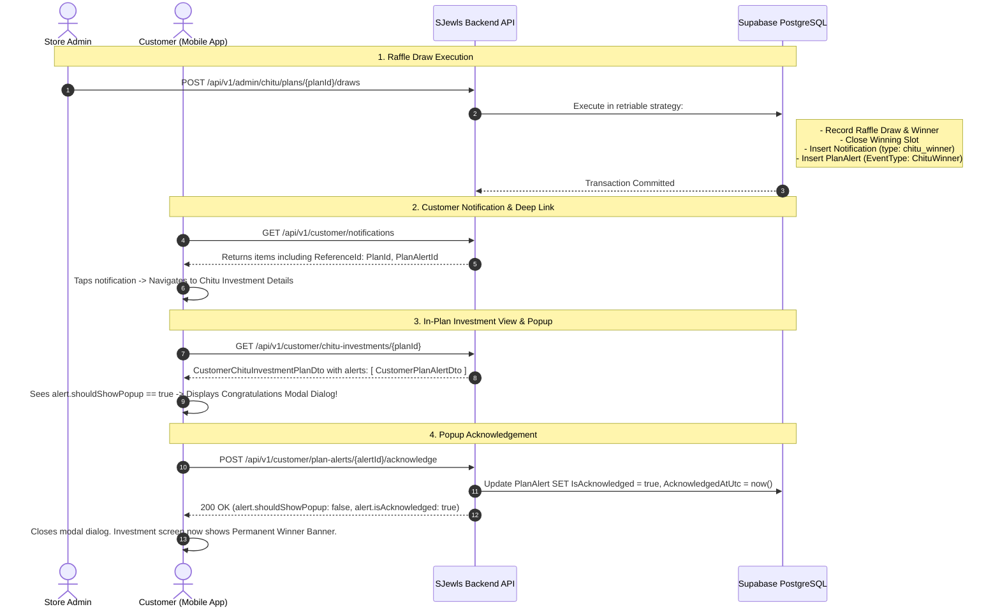
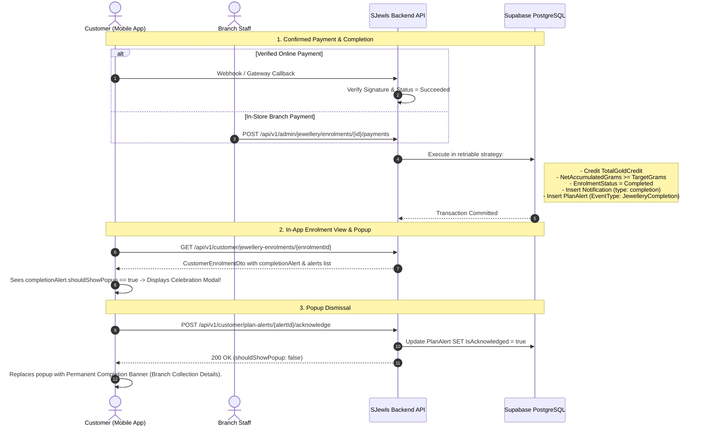

# SJewls Mobile Plan Alerts & Winner Notifications Integration Guide

**Version:** 1.0.0  
**Target Clients:** SJewls Customer Mobile App (Flutter / iOS / Android)  
**Interactive Scalar API Reference:** `https://sjewls.onrender.com/scalar/mobile` (Production) | `http://localhost:5230/scalar/mobile` (Local)  
**OpenAPI Specification:** `docs/SJewls_Customer_Mobile_OpenAPI_Complete.json` & `.yaml`  
**Base URL (Production):** `https://sjewls.onrender.com`  
**Base URL (Local Development):** `http://localhost:5230`  

---

## 1. Overview & Architectural Principles

The SJewls platform provides persistent customer notifications and plan-specific alerts for two major milestone events:
1. **Chitu Raffle Winner:** An authorized admin records the official monthly raffle draw and confirms a customer's slot as the winner.
2. **Jewellery Plan Completion:** Confirmed, trusted payments (either verified online payments or authorized in-store cash payments) bring an individual jewellery enrolment to its target gold grams.

### The Three-Tier Alert Architecture

To provide an exceptional user experience while keeping financial and physical claim states strictly segregated, each event produces three coordinated representations:

```
+-----------------------------------------------------------------------------------+
| 1. In-App Notification Feed (Inbox)                                               |
|    - Stored in Notifications table                                                |
|    - Displayed in Customer Notification Center (bell icon)                        |
|    - Deep-links directly to the relevant investment view via ReferenceId/Target |
+-----------------------------------------------------------------------------------+
                                      │
                                      ▼
+-----------------------------------------------------------------------------------+
| 2. Milestone Modal Popup Dialog                                                   |
|    - Driven by PlanAlert entity where ShouldShowPopup = true                      |
|    - Appears when customer navigates into the relevant investment screen          |
|    - Customer taps "Acknowledge" / "Got it" to dismiss                            |
|    - Dismissal calls POST /api/v1/customer/plan-alerts/{alertId}/acknowledge      |
+-----------------------------------------------------------------------------------+
                                      │
                                      ▼
+-----------------------------------------------------------------------------------+
| 3. Permanent In-Plan Banner                                                       |
|    - Remains visible indefinitely inside the plan/enrolment screen                |
|    - Driven by PlanAlert entity where ShouldShowPopup = false                     |
|    - Informs the customer of branch address, contact phone, and collection instructions|
+-----------------------------------------------------------------------------------+
```

---

## 2. Core Separation of States

The backend enforces strict separation between notification inbox status, popup alert dismissal, and physical prize handover:

| State Dimension | Field / Entity | Controlled By | Description |
| :--- | :--- | :--- | :--- |
| **Inbox Read State** | `Notification.IsRead` | Customer (`PATCH /notifications/{id}/read`) | Marks inbox item read. **Does NOT** dismiss the in-plan popup. |
| **Popup Alert State** | `PlanAlert.IsAcknowledged` / `ShouldShowPopup` | Customer (`POST /plan-alerts/{id}/acknowledge`) | Dismisses the popup dialog. **Does NOT** mark inbox item read or claim physical item. |
| **Physical Claim State** | `ChituWinnerBenefit.Status` / `JewelleryEnrolment.Status` | Store Staff / Admin (In-store verification) | Records the customer physically taking possession of gold/jewellery at the counter. |

> [!IMPORTANT]
> The mobile application **must not assume** that reading an inbox notification dismisses the in-plan popup, nor that dismissing the popup automatically claims the physical prize. Each state is tracked independently by the backend.

---

## 3. Chitu Raffle Winner Alert Flow

### Lifecycle & Rules
1. **Trigger:** An authorized staff administrator records a completed raffle draw for a Chitu savings plan via admin portal (`POST /api/v1/admin/chitu/plans/{planId}/draws`).
2. **Atomic Persistence:** In the same database transaction:
   - Winner is recorded in `ChituRaffleDraws` and `ChituWinnerBenefits`.
   - The winning slot's status transitions to `Won`.
   - An inbox `Notification` of type `chitu_winner` is created.
   - A `PlanAlert` of event type `ChituWinner` is created with `IsAcknowledged = false` and `ShouldShowPopup = true`.
3. **Scheduled Date Resolution:** The notification and alert use the **scheduled raffle round's month/year** (e.g., `"November 2026"`), rather than the arbitrary timestamp when staff entered the draw in the portal.
4. **Multi-Slot Safety:** If a customer owns multiple slots (e.g., Slot 4 and Slot 12), the alert unambiguously identifies the winning slot (e.g., `SlotNumber: 4`, `SlotDisplayCode: "SLOT-004"`).
5. **Prize Modality:** Respects whether the plan is **Gold** or **Cash** redemption (`RedemptionType: "Gold"` or `"Cash"`), displaying the authoritative prize value.

### Chitu Winner Sequence Diagram



---

## 4. Jewellery Plan Completion Alert Flow

### Lifecycle & Rules
1. **Trigger:** Confirmed financial transactions bring the customer's `NetAccumulatedGoldGrams` to `TargetGrams`. This occurs via:
   - **Online Payments:** Gateway callback verification via `JewelleryPaymentFinalizationService.FinalizePaymentAsync`.
   - **In-Store Payments:** Staff cash deposit via `AdminJewelleryEnrolmentService.RecordPaymentAsync`.
2. **Atomic Persistence:** When target grams are met:
   - The enrolment status transitions to `Completed`.
   - An inbox `Notification` of type `completion` is created.
   - A `PlanAlert` of event type `JewelleryCompletion` is created with `IsAcknowledged = false` and `ShouldShowPopup = true`.
3. **EventType Reconciliation (`JewelleryCompletion` vs `JewelleryPlanCompletion`):**
   - **Canonical Stored Database Value:** `JewelleryCompletion` (aligned with the PostgreSQL filtered unique index `IX_PlanAlerts_JewelleryEnrolmentId_EventType`).
   - **Supported Alias:** `JewelleryPlanCompletion`.
   - **Contract Reconciliation:** The backend query and mapping layers accept both identifiers (`a.EventType == "JewelleryCompletion" || a.EventType == "JewelleryPlanCompletion"`). All existing production alerts previously stored in Supabase under `JewelleryCompletion` remain 100% retrievable. In mobile DTOs and OpenAPI documentation, both names are recognized.
4. **No False Triggers:** Previews, 5-minute locked quotes, pending payments, failed payments, or client claims **never** trigger completion alerts.
5. **Immediate Collection:** Customers can collect jewellery immediately from their designated branch counter without waiting for extra backend collection approvals.
6. **Separation from Physical Collection:** Marking jewellery as physically handed over at the counter remains an independent staff action.

### Jewellery Completion Sequence Diagram



---

## 5. API Reference & Payloads

### 5.1 Acknowledge Plan Alert
- **Endpoint:** `POST /api/v1/customer/plan-alerts/{alertId}/acknowledge`
- **Authentication:** Bearer JWT (Customer token)
- **Path Parameter:** `alertId` (UUID) - ID of the `PlanAlert`
- **Idempotency:** Safe and idempotent. Repeat calls return HTTP 200 with the already acknowledged state.

#### Request Headers
```http
POST /api/v1/customer/plan-alerts/7c9e6679-7425-40de-944b-e07fc1f90ae7/acknowledge HTTP/1.1
Host: sjewls.onrender.com
Authorization: Bearer <Customer_JWT_Token>
Content-Length: 0
```

#### Response 200 OK
```json
{
  "success": true,
  "message": "Plan alert acknowledged successfully.",
  "alert": {
    "alertId": "7c9e6679-7425-40de-944b-e07fc1f90ae7",
    "eventType": "ChituWinner",
    "title": "Chitu Raffle Winner!",
    "message": "Congratulations! Your slot 4 in Royal Gold Savings Plan has won Round 3 for November 2026. Visit Colombo Main Branch to collect your Gold prize.",
    "planId": "3fa85f64-5717-4562-b3fc-2c963f66afa6",
    "planName": "Royal Gold Savings Plan",
    "referenceId": "3fa85f64-5717-4562-b3fc-2c963f66afa6",
    "slotId": "9b1deb4d-3b7d-4bad-9bdd-2b0d7b3dcb6d",
    "slotNumber": 4,
    "slotDisplayCode": "SLOT-004",
    "roundIndex": 3,
    "scheduledMonthYear": "November 2026",
    "redemptionType": "Gold",
    "prizeAmount": 500000.0,
    "enrolmentId": null,
    "targetGrams": null,
    "branchId": "e1f13b1a-8c8e-4a6c-9418-2e0f55cfa791",
    "branchName": "Colombo Main Branch",
    "outletAddress": "123 Galle Road, Colombo 03",
    "outletPhone": null,
    "eventTimestampUtc": "2026-11-19T03:30:00Z",
    "acknowledgedAtUtc": "2026-11-19T03:35:12Z",
    "isAcknowledged": true,
    "shouldShowPopup": false,
    "navigationTarget": "chitu_slot_detail",
    "collectionInstruction": "Please bring your original National Identity Card (NIC) to Colombo Main Branch to claim your prize."
  }
}
```

#### Error Responses
- `401 Unauthorized`: Missing or expired Bearer token.
- `403 Forbidden`: Attempting to acknowledge an alert belonging to a different customer.
- `404 Not Found`: Alert ID does not exist.

---

### 5.2 Customer Notifications Endpoint
- **Endpoint:** `GET /api/v1/customer/notifications?page=1&pageSize=20`
- **Enriched Fields:**
  - `referenceId`: UUID of the associated investment (`PlanId` or `EnrolmentId`).
  - `referenceType`: Category string (`"ChituPlan"` or `"JewelleryEnrolment"`).
  - `planAlertId`: Direct foreign key to the `PlanAlert` record.

#### Response Snippet
```json
{
  "items": [
    {
      "id": "a2b3c4d5-1111-2222-3333-444455556666",
      "title": "Chitu Raffle Winner!",
      "message": "Congratulations! Your slot 4 in Royal Gold Savings Plan has won Round 3 for November 2026. Visit Colombo Main Branch to collect your Gold prize.",
      "type": "chitu_winner",
      "isRead": false,
      "readAtUtc": null,
      "createdAtUtc": "2026-11-19T03:30:00Z",
      "referenceId": "3fa85f64-5717-4562-b3fc-2c963f66afa6",
      "referenceType": "ChituPlan",
      "planAlertId": "7c9e6679-7425-40de-944b-e07fc1f90ae7"
    },
    {
      "id": "b3c4d5e6-2222-3333-4444-555566667777",
      "title": "Jewellery Plan Completed!",
      "message": "Congratulations! You have completed Gold Sovereign Savings and reached your target of 8.000 g. Visit Colombo Main Branch to collect your jewellery.",
      "type": "completion",
      "isRead": true,
      "readAtUtc": "2026-11-19T03:32:00Z",
      "createdAtUtc": "2026-11-19T03:31:00Z",
      "referenceId": "c4d5e6f7-3333-4444-5555-666677778888",
      "referenceType": "JewelleryEnrolment",
      "planAlertId": "d5e6f7a8-4444-5555-6666-777788889999"
    }
  ],
  "totalCount": 2,
  "unreadCount": 1,
  "page": 1,
  "pageSize": 20,
  "totalPages": 1
}
```

---

### 5.3 Chitu Investment & Slot Endpoints

#### `GET /api/v1/customer/chitu-investments/{planId}`
Returns `CustomerChituInvestmentPlanDto`:
- `alerts`: List of `CustomerPlanAlertDto` for any winning slots under this savings plan.
- If any alert has `shouldShowPopup == true`, mobile displays the winner popup on entering this screen.

#### `GET /api/v1/customer/chitu-slots/{slotId}`
Returns `CustomerChituSlotDetailDto`:
- `winnerAlert`: Dedicated `CustomerPlanAlertDto?` for this specific slot.
- Enables slot-level banner display and winner badge.

---

### 5.4 Jewellery Enrolment Details Endpoint

#### `GET /api/v1/customer/jewellery-enrolments/{enrolmentId}`
Returns `CustomerEnrolmentDto`:
- `completionAlert`: `CustomerPlanAlertDto?` populated when target grams are achieved.
- `alerts`: List of `CustomerPlanAlertDto`.
- If `completionAlert.shouldShowPopup == true`, mobile displays the completion celebration dialog.

---

## 6. Mobile Client Implementation Blueprint (Flutter)

### UI Logic Matrix

```dart
void handleInvestmentScreenLoad(BuildContext context, List<CustomerPlanAlertDto> alerts) {
  // 1. Check for unacknowledged popup alerts
  final popupAlert = alerts.firstWhereOrNull((a) => a.shouldShowPopup);
  if (popupAlert != null) {
    showMilestoneCelebrationDialog(context, popupAlert);
  }
}

Future<void> showMilestoneCelebrationDialog(BuildContext context, CustomerPlanAlertDto alert) async {
  await showDialog(
    context: context,
    barrierDismissible: false,
    builder: (ctx) => AlertDialog(
      title: Row(
        children: [
          Icon(alert.eventType == 'ChituWinner' ? Icons.emoji_events : Icons.verified, color: Colors.amber),
          const SizedBox(width: 8),
          Expanded(child: Text(alert.title)),
        ],
      ),
      content: Column(
        mainAxisSize: MainAxisSize.min,
        crossAxisAlignment: CrossAxisAlignment.start,
        children: [
          Text(alert.message),
          const SizedBox(height: 12),
          Text(alert.collectionInstruction, style: const TextStyle(fontWeight: FontWeight.w600)),
          if (alert.outletAddress != null) ...[
            const SizedBox(height: 8),
            Text('Location: ${alert.outletAddress}'),
          ],
        ],
      ),
      actions: [
        FilledButton(
          onPressed: () async {
            // Dismiss dialog locally
            Navigator.of(ctx).pop();
            // Call acknowledgement API in background
            await apiService.acknowledgePlanAlert(alert.alertId);
          },
          child: const Text('Got it!'),
        ),
      ],
    ),
  );
}
```

### Deep-Linking Routing Guide

When the user taps an inbox notification in the notifications feed:
1. Read `referenceType` and `referenceId`.
2. Route based on type:
   - If `referenceType == "ChituPlan"`: Navigate to `ChituInvestmentDetailScreen(planId: referenceId)`.
   - If `referenceType == "JewelleryEnrolment"`: Navigate to `JewelleryEnrolmentDetailScreen(enrolmentId: referenceId)`.
   - If `referenceType == "ChituSlot"`: Navigate to `ChituSlotDetailScreen(slotId: referenceId)`.

---

## 7. Historical Backfill Policy

When seeding or migrating historical Chitu raffle winners or already completed Jewellery enrolments into the `PlanAlerts` table:
1. **Set `IsAcknowledged = true`** and `AcknowledgedAtUtc = EventTimestampUtc`.
2. **Result:** `ShouldShowPopup` evaluates to `false`.
3. **Benefit:** Prevents existing customers from experiencing a flood of historical popups upon upgrading their mobile app, while still providing them with the permanent collection banners inside their investment screens.

---

## 8. Verification & QA Matrix

The alerts subsystem has been verified against Supabase PostgreSQL and automated test suites:

| Test Case | Scenario Tested | Outcome |
| :--- | :--- | :--- |
| `RecordRaffleDraw_CreatesAtomically` | Admin confirms raffle draw with scheduled month. | Inbox notification + `PlanAlert` created atomically with `ShouldShowPopup = true`. |
| `JewelleryCompletion_OnlinePayment` | Gateway callback completes final gold gram. | Enrolment marked `Completed`, inbox notification + `PlanAlert` created. |
| `JewelleryCompletion_InStorePayment` | Branch staff enters cash payment completing target. | Enrolment marked `Completed`, inbox notification + `PlanAlert` created. |
| `AcknowledgePlanAlert_Idempotency` | Customer acknowledges popup multiple times. | Returns 200 OK every time; `ShouldShowPopup = false`, banner remains. |
| `AcknowledgePlanAlert_OwnershipGuard` | Customer B tries to acknowledge Customer A's alert. | Returns 403 Forbidden. |
| `IndependentStates_Verified` | Inbox notification marked read. | `PlanAlert.IsAcknowledged` remains `false` until modal dismissal. |
| `Postgres_TransactionRetry_Supported` | Real PostgreSQL with retries enabled. | Zero strategy crashes, atomic commits. |
| `Postgres_ConcurrentAndRetried_ChituWinner` | Concurrent/retried raffle draw confirmation in PostgreSQL. | Exactly 1 draw, 1 benefit, 1 alert, 1 notification. Duplicate filtered unique index enforces DB-level uniqueness. |
| `Postgres_ConcurrentAndRetried_JewelleryCompletion` | Concurrent/retried jewellery completion in PostgreSQL. | Exactly 5.0g saved (no duplicate financial credit!), 1 contribution, 1 alert, 1 notification. |
| `Postgres_CompetingPayments_ForFinalRemainingGrams` | Competing payments reach target; subsequent verified payment exceeds remaining. | Full money (LKR 30,000) & original quoted gold (1.0g) preserved in `PaymentStatus.RequiresReconciliation`. 0g credited to enrolment, strict 5.0g target preserved. |
| `Postgres_InStorePayment_ExceedingRemainingTarget` | In-store cash payment exceeding target attempted at counter. | Rejected before collection with `ArgumentException`. Zero payments or balances written. |
| `Postgres_ReconciliationCallbackReplay` | Gateway callback replay on used quote / provider reference. | Inspects linked payment, returns existing reconciliation outcome (`RequiresReconciliation = true`, `Success = false`). Never reports success. Cross-quote reference re-use rejected. |
| `Postgres_TransientFailure_ExecutionStrategyRetry` | Transient network/timeout on attempt 1. | Npgsql retry strategy recovers on attempt 2 with fresh tracked state and clean atomic commit. |
| `Postgres_AlertAcknowledgement_TimestampPreservation` | Concurrent / repeated acknowledgement calls across threads. | Atomic conditional update (`COALESCE`) strictly preserves the first timestamp across all callers. |

---

## 9. Production Messaging Gateways & Delivery Specifications

The backend handles external messaging for customer authentication and notifications via the following production gateways:

1. **SMS Delivery (`ISmsSender`):**
   * **Active Provider:** SMSlenz.lk via `SmsLenzSmsSender`.
   * **Endpoint:** `POST https://smslenz.lk/api/send-sms`
   * **Payload Structure:** `{ "user_id": "...", "api_key": "...", "sender_id": "...", "contact": "+947XXXXXXXX", "message": "..." }`
   * **Normalization:** Recipient phone numbers are automatically normalized to E.164 `+94` format (e.g. `0771234567` -> `+94771234567`).
   * **No Automatic Fallback:** When `SmsLenz` is selected, delivery rejections or timeouts immediately fail the operation to prevent ambiguous dispatch states.
   * **Rollback Switch:** `TextLkSmsSender` (`https://app.text.lk/api/v3/sms/send`) is preserved strictly as a configuration-only switch (`Sms:Provider = "TextLk"`).

2. **Email Delivery (`IEmailOtpProvider` / `IEmailSender`):**
   * **Primary Transport:** Gmail API (`GmailApi`) via HTTPS REST endpoint `POST https://gmail.googleapis.com/gmail/v1/users/me/messages/send` authenticated via Google OAuth2 Bearer tokens (`GmailClientId`, `GmailClientSecret`, `GmailRefreshToken`).
   * **Alternative Transport:** Direct SMTP (`Smtp`) via MailKit to `smtp.gmail.com:587` with STARTTLS and Google App Passwords.

---

## 10. Competing Payments, Reconciliation State & Gateway Replay Policies

### 1. Pre-Collection vs. Post-Collection Integrity
* **In-Store Payments (Pre-Collection):** Cash payments are rejected **before collection** whenever the entered amount or gram weight would cause total saved gold to exceed the target weight (`ArgumentException`). Under PostgreSQL row locking (`FOR NO KEY UPDATE`), a second guard re-evaluates the latest balance and aborts if concurrent activity reduced the remaining capacity (`InvalidOperationException`). Zero cash is accepted, zero payment rows are recorded, and zero gold is credited.
* **Online Gateway Payments (Post-Collection):** When an online payment is confirmed by a gateway webhook, customer funds have **already been collected**. If a concurrent payment completed the enrolment first, crediting the full quoted grams would overrun the target. Rather than discarding or silently trimming the customer's gold, the backend places the transaction into an explicit reconciliation state:
  * `Payment.Status = PaymentStatus.RequiresReconciliation` (Value `7`).
  * `Payment.Amount` preserves the full monetary amount collected (`quote.AmountToPay`).
  * `Payment.Remarks` flags: `"REQUIRES RECONCILIATION: Payment collected LKR ... for quoted ...g, but crediting exceeds remaining target ...g. Zero gold credited to prevent target overrun. Flagged for store reconciliation."`
  * `JewelleryPaymentQuote.TotalGoldCredit` preserves the exact original quoted grams.
  * `PaymentFinalizationResult` returns `Success = false`, `RequiresReconciliation = true`, `GoldGramsCredited = 0m`.

### 2. Idempotent Gateway Callback Replay
* **Replay of Reconciliation Quotes:** If an external payment gateway retries a webhook or if the mobile app replays payment verification for a used quote in `RequiresReconciliation` status, the backend inspects the linked payment and returns the **existing reconciliation outcome**. It **never reports the payment as successfully credited**.
* **Provider Reference Uniqueness & Ownership:** If a gateway callback provides a `ProviderReference` that already exists in the database, the backend validates that it belongs to the **exact same payment and quote**. If a client attempts to use a previously finalized `ProviderReference` with a different quote ID, the request is immediately rejected with `409 Conflict / InvalidOperationException`.

### 3. Payment History Mappings & Financial Aggregates
* **Customer Payment History (`GET /api/v1/customer/payments`):**
  * `status`: `"RequiresReconciliation"`.
  * `amount`: Full LKR amount received.
  * `summaryDescription`: `"Payment collected (LKR X): Exceeds target, flagged for store reconciliation"`.
  * Customer can view full breakdown including original quote reference and store notes.
* **Enrolment Payment List (`GET /api/v1/customer/jewellery-enrolments/{id}/payments`):**
  * Explicitly includes reconciliation payments with `status: "RequiresReconciliation"`, `goldGramsCredited: 0.0`.
* **Financial Aggregates & Balances:**
  * `TotalSavedGrams` and `TotalContributedCurrency` in `CustomerJewelleryPlanDto` and enrolment summaries **strictly query only `PaymentStatus.Succeeded`**.
  * Payments in `RequiresReconciliation` are **excluded from gold savings balances**, ensuring the plan's target weight is strictly respected until branch staff perform a physical resolution or refund.

### 4. Mobile Client UX Guidelines
When the mobile app detects `status == "RequiresReconciliation"` or receives a payment response with `requiresReconciliation: true`:
1. **Status Badge:** Display an orange/amber badge with text `"Pending Store Reconciliation"`.
2. **Customer Notice:** Show an informative modal or card:  
   *"We have received your payment of LKR {amount}. Because your jewellery plan target was completed by a concurrent payment, zero grams were added to avoid exceeding your plan limit. Your funds are secure, and our store team will contact you to allocate this credit or issue a refund. You may also visit your registered branch."*
3. **Do Not Display Plan as Over-Target:** Do not calculate progress beyond 100%. Plan remains at exactly its target weight.

